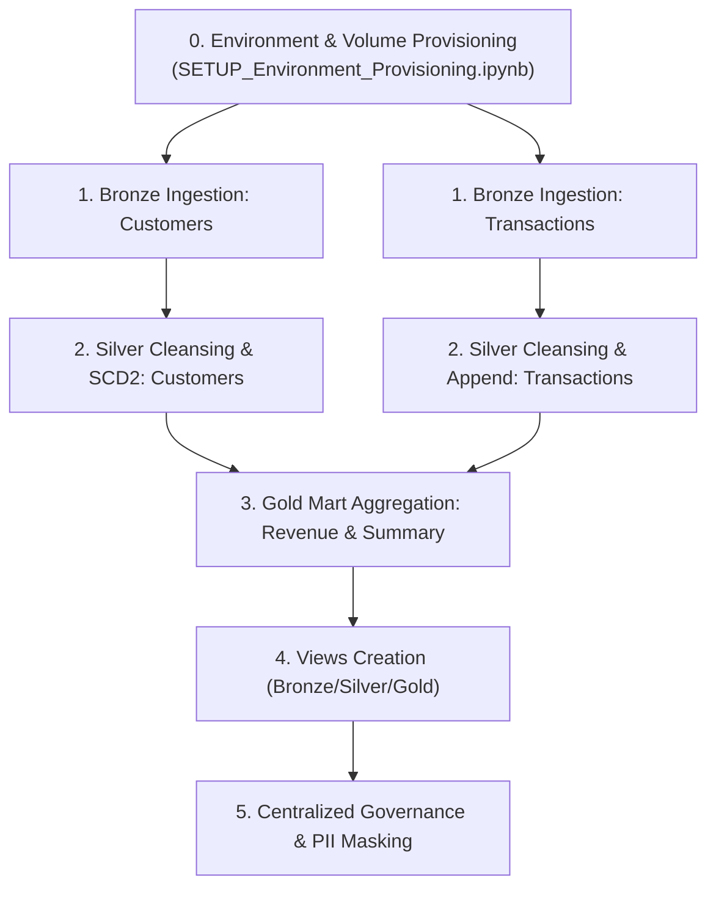

# 🔄 Orchestration & Deployment Architecture

This guide details how LakeForge pipelines are scheduled, orchestrated, and deployed across enterprise schedulers: **Databricks Workflows (Asset Bundles)**, **Apache Airflow**, and **Azure Data Factory**.

---

## 0. Branching & Environment Policy (Enforced in CI/CD)

All development happens in **dev** (any branch: `main`, `dev`, `feature/**`, `bugfix/**`). Every other environment builds from **`main` only** — no feature-branch runs outside dev.

| Environment | Allowed Source Branch | Trigger Type | Deployment Mode |
|---|---|---|---|
| **dev** | ANY branch (`main`, `dev`, `feature/**`, `bugfix/**`) | CI on every push / PR | Development (`~/.lakeforge/...`) |
| **test** | `main` only | Automatic on push to `main` (dev ➔ test promotion) | Production (`mode: production`) |
| **staging** | `main` only | Manual workflow dispatch from `main` | Production (`mode: production`) |
| **prod** | `main` only | Manual workflow dispatch from `main` with approval gate | Production (`mode: production`) |

### How It is Enforced

1. **GitHub Actions (`.github/workflows/ci_cd.yml`)**: Push to `main` builds and deploys **test**; pushes to `dev`/`feature/**`/`bugfix/**` deploy to **dev** only. A hard guard step (`Enforce Branch Policy`) fails the run with an error if any stage other than dev is requested while not on `main`.
2. **Azure DevOps (`azure-pipelines.yml`)**: The same guard step in `DeployStage`: `stage != dev` and `branch != main` ➔ run immediately fails.
3. **Databricks Asset Bundles (`databricks.yml`)**: The `test`, `staging`, and `prod` bundle targets use `mode: production` (locked bundle state, no uncommitted changes, no destructive permission changes); `dev` uses a user-scoped `root_path` so job names stay clean and personal deployments stay isolated.

### Immutability of Deployed Branches
- **GitHub**: Branch protection rule for `main`: require pull request + reviews, block direct pushes, restrict deletions. Changes reach `main` only through reviewed PRs.
- **Azure DevOps**: Repos ➔ Branch Policies on `main`: require a minimum number of reviewers and linked work items, prohibit self-approval.

---

## 0.5 Multi-Bundle Deployment Layout (Per-Client Bundles)

Databricks' recommended multi-bundle pattern: **one repo, one bundle per deployment unit**. Each client is an **independent bundle** — deploying or running one client never touches another.

```text
lakeforge/
├── databricks.yml                              # MAIN bundle (global medallion job)
├── deployments/                                # PER-CLIENT bundles (one independent bundle per client)
│   ├── _template/                              # CLIENT BLUEPRINT (starter bundle for onboarding new clients)
│   │   ├── databricks.yml                      # Template bundle definition
│   │   └── resources/
│   │       └── environment_setup.job.yml       # First-run provisioning job
│   └── client_alpha/
│       ├── databricks.yml                      # CLIENT bundle (independent)
│       └── resources/
│           ├── environment_setup.job.yml       # Mandatory client provisioning job
│           ├── client_alpha_etl_job.yml        # provisioning(client_alpha) -> bronze -> silver -> views -> governance
│           └── client_alpha_views_job.json     # on-demand views refresh (JSON works alongside YML)
└── infrastructure/
    └── databricks/resources/
        └── lakeforge_global_job.yml            # provisioning(env) -> bronze -> silver -> gold -> views -> governance
```

### Adding a New Client (Onboarding Runbook)
1. Copy the blueprint template:
   ```bash
   cp -r deployments/_template deployments/<new_client>
   ```
2. In `deployments/<new_client>/databricks.yml`, change `name: lakeforge-client-template` to `name: lakeforge-<new_client>`.
3. Add client-specific configurations under `configs/<category>/<new_client>/`.
4. Run stage synchronization to generate all environment targets:
   ```bash
   lakeforge sync-stages
   ```
5. Deploy and run the first-time provisioning job:
   ```bash
   cd deployments/<new_client>
   databricks bundle deploy -t dev
   databricks bundle run environment_setup -t dev
   ```
6. **Zero changes** are needed in the main global bundle!

---

## 0.7 Stage Registry & Multi-Account Deployment

Stage names are defined in ONE single source of truth: **`configs/environments/env_settings.json`**.

### Multi-Account Stages (`workspace_host`)
To host a stage (e.g. `test` or `prod`) in a **different Databricks workspace / cloud account**:
1. Add `workspace_host` in that stage's object in `env_settings.json`:
   ```json
   "prod": {
     "workspace_host": "https://dbc-enterprise-prod.cloud.databricks.com",
     "catalogs": { ... }
   }
   ```
2. Run `lakeforge sync-stages` — automatically injects the `host:` property into every bundle target for that stage.
3. **Never put secrets in `env_settings.json`** — credentials must remain in CI secrets / variable groups.
4. **Service Principal OAuth (Recommended)**: Set `DATABRICKS_<STAGE>_CLIENT_ID` + `DATABRICKS_<STAGE>_CLIENT_SECRET`.

---

## 0.8 Mirrored CI/CD Pipeline Suite

LakeForge provides an identical set of four automated and manual workflows in both **GitHub Actions** (`.github/workflows/`) and **Azure DevOps** (`azure-pipelines/workflows/`):

| Workflow | Trigger | Description |
|---|---|---|
| **`ci_cd.yml`** | Push to PR / merge to `main` | Linting, unit tests, integration tests, stage drift check (`sync-stages --check`), and automated deployment. |
| **`pr_review.yml`** | Pull request open/synchronize | Automated PR code reviewer, AST duplicate function detection, test coverage validation. |
| **`dab_deploy.yml`** | Manual dispatch / schedule | Deploys bundle targets with optional `run_setup` first-deployment provisioning. |
| **`dab_export.yml`** | Manual dispatch | Reverse-engineers live Databricks Workflows into version-controlled DAB manifests. |

### Deploying a Single Client
- **Deploy Global Bundle**:
  ```bash
  databricks bundle deploy -t dev
  ```
- **Deploy Only Client Alpha**:
  ```bash
  cd deployments/client_alpha && databricks bundle deploy -t dev
  ```
- **Run Client Alpha ETL**:
  ```bash
  databricks bundle run client_alpha_etl_pipeline -t dev
  ```
- **Via LakeForge CLI**:
  ```bash
  lakeforge deploy --stage dev --client client_alpha
  ```

### Path Resolution in Bundles
- Client bundles sync the shared framework (`pipelines/`, `configs/`, `lakeforge/`) from the repo root via `sync.paths` using `../../` (two levels up from client bundle root).
- Relative paths in resource files (`notebook_path`) resolve relative to the **resource file's location**: `../../../pipelines/...` reaches the repo root from **both** `infrastructure/databricks/resources/` and `deployments/<client>/resources/`.

---

## 1. Databricks Workflows (Multitask DAG)

Databricks Workflows is the primary scheduler for LakeForge pipelines due to native integration with Unity Catalog, Serverless / Job compute, and task logging.

### Ideal Multitask Job Structure



---

## 2. Apache Airflow Integration

For external cross-cloud scheduling, trigger LakeForge notebook tasks via `DatabricksSubmitRunOperator` or `DatabricksRunNowOperator`:

```python
from airflow import DAG
from airflow.providers.databricks.operators.databricks import DatabricksRunNowOperator
from datetime import datetime

with DAG(
    dag_id="lakeforge_etl_pipeline",
    start_date=datetime(2026, 1, 1),
    schedule_interval="@daily",
    catchup=False,
    tags=["lakeforge", "databricks"]
) as dag:

    trigger_provisioning = DatabricksRunNowOperator(
        task_id="provision_environment",
        databricks_conn_id="databricks_default",
        job_id="1029384756",
        notebook_params={"environment": "prod"}
    )

    trigger_bronze = DatabricksRunNowOperator(
        task_id="ingest_bronze",
        databricks_conn_id="databricks_default",
        job_id="2938475610",
        notebook_params={"environment": "prod", "source_name": "sales"}
    )

    trigger_silver = DatabricksRunNowOperator(
        task_id="transform_silver",
        databricks_conn_id="databricks_default",
        job_id="3948576102",
        notebook_params={"environment": "prod", "client_id": "client_alpha"}
    )

    trigger_provisioning >> trigger_bronze >> trigger_silver
```
